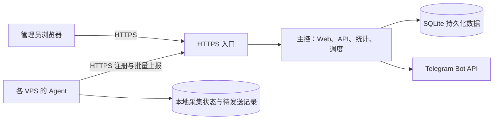
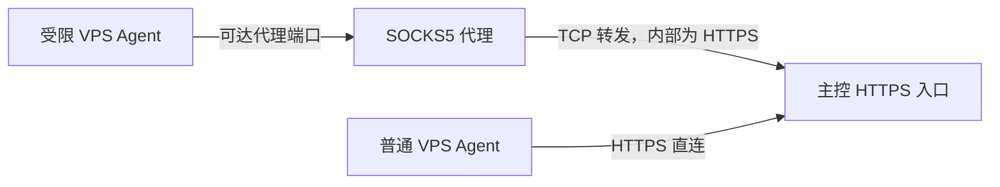

**VPS 流量监控系统设计方案 v1.2（Python 实现）**

编写日期：2026 年 11 月 3 日。状态：Python 本地版本已实现并完成部分验收；Docker 文件已提供，尚未部署。实际完成范围和待验证项以 README.md、TESTING.md、DEPLOY.md 为准。

**一、目标与已确认需求**

系统服务于个人管理的多台 VPS。每台机器的商家、流量额度和重置日期可能不同。商家没有可用 API，用户接受近似统计，希望提前发现额度不足，并通过 Telegram 收到每日报告和告警。

采用“首次人工校准商家余额 + Agent 持续记录新增流量 + 按配置周期重新计账”的方式。中心服务部署在 Debian 13 VPS，通过 Docker Compose 运行。Web 生成节点专属安装命令；用户在目标 VPS 上执行一次后，Agent 自动启动并开机自启。

第一版功能范围：多节点管理、收发流量采集、本地持久化、重启续算、断线补报、人工余额校准、每节点独立月度周期、Web 查询、Telegram 日报和即时告警、安装与升级、备份恢复，以及每节点独立 SOCKS5 代理。代理覆盖首次安装、注册、日常上报、检查点交互和升级下载。

自动限速、停服务、关机和商家后台抓取属于后续独立扩展。本版的 Agent 权限和通信协议围绕采集设计，不加入任意远程命令执行。

统计精度目标是“足够用于提前提醒”。页面与消息统一使用“预计剩余”，不承诺与商家账单逐字节相同。不人为设定未经实测的固定误差百分比。

**二、整体结构与技术选型**



按用户确认，改用以下 Python 技术栈：

| 部分 | 方案 | 理由 |
|---|---|---|
| 中心后端 | Python 3.11+ / FastAPI，单进程 | API、统计与调度放在同一服务，便于维护 |
| Web | Vue 3 + TypeScript + Vite | 提供中文界面与手机可用的布局 |
| 前端发布 | Vite 静态产物由 FastAPI 提供 | 生产环境只运行中心服务，不额外运行 Node |
| 中心数据库 | SQLite，本地磁盘，WAL 模式 | 先满足个人多节点场景，减少部署组件 |
| Agent | Python 3.11+，Linux / Windows | Linux 发布包内置纯 Python 依赖；Windows 使用 psutil |
| Agent 状态 | 本地 SQLite | 在事务中保存采集游标和待上报记录 |
| 主控部署 | Docker Compose | 依赖锁定、数据卷、健康检查；基础镜像目前为版本系列标签 |
| Agent 托管 | systemd | 开机自启、异常退出重启、日志管理 |
| 接入方式 | Agent 主动 HTTPS 上报，可经 SOCKS5 代理 | 节点端不需要新增入站监听端口；连接模式按节点配置 |
| 通知 | 主控调用 Telegram Bot API | 统一发送和重试，Agent 不保存 Bot Token |

Debian 13 属于 Docker 官方列出的支持系统。[S1] 第一版主控按单实例运行；SQLite 存放于本地持久化磁盘。本方案暂以 1～50 个节点作为初始验证规模，实际资源指标通过实现后的压测确定，不作为性能承诺。

本版由 Agent 直接读取 Linux 网卡计数，不依赖用户预装 vnStat。之前讨论的 vnStat 是可选采集基础；统一 Agent 能更直接管理安装、采集游标、周期和补报。

**三、用户使用流程**

1. 先在 Windows 本机启动主控和 Agent 验证流程，再在 Debian 13 部署 Docker Compose 并配置 HTTPS 入口。
2. 使用部署时生成的一次性初始化凭据创建管理员，关闭公开初始化入口。
3. 在通知设置填写 Telegram Bot Token、Chat ID 和报告时区，点击测试通知。
4. 点击“添加服务器”，输入名称和可选分组，生成 30 分钟有效、单次使用的注册凭据及安装命令。
5. 在目标 VPS 用 root 执行安装命令。需要代理的节点，在安装流程一开始就设置 SOCKS5 地址和可选认证，脚本、Python 发布包及校验清单下载均使用同一连接策略。安装器检查 Python 3.11+ 和 systemd、校验程序、创建受限服务账号、注册节点并启动 systemd 服务。完全无法在线获取脚本时使用离线包方式，见第十六节。
6. 面板显示节点在线、发现的网卡与采集预览；用户确认要计费的接口。
7. 填写总额度、单位、计费方向、下次重置日期与周期规则，输入商家当前剩余流量进行首次校准。
8. 系统持续估算剩余额度，并按设置发送 Telegram 消息。

注册成功但未校准的节点也记录实际收发流量；此时不显示假定的商家余额，不触发额度告警。

**四、每台 VPS 的配置模型**

| 字段 | 说明 |
|---|---|
| 名称、分组、备注 | 如“香港 01”“代理节点”；商家名称仅用于标识 |
| 统计网卡 | 自动发现并建议默认出口，用户确认；本例 eth0 |
| 总额度 | 每周期额度，按所选单位转换为整数 bytes |
| 单位 | GB/TB（1000 进制）或 GiB/TiB（1024 进制） |
| 计费方向 | 出站 TX、入站 RX、双向相加 |
| 下次重置时间 | 明确日期、时间及 IANA 时区 |
| 每月重置日 | 1～31 日；当月没有该日期时用当月最后一天 |
| 时间确认状态 | 已确认，或使用用户选择的暂定值 |
| 首次/再次校准余额 | 商家此时展示的剩余值 |
| 通知规则 | 可继承全局默认值，也可单节点覆盖 |
| 主控连接模式 | 直接连接，或仅通过 SOCKS5 连接；第一版不自动切换到直连 |
| 代理参数 | 主机、端口、可选用户名与密码；默认由代理解析目标域名 |

月末规则保留原始“重置日”，例如每月 31 日的配置在 2 月使用最后一天，3 月仍回到 31 日，不永久漂移。

“还有 N 天”可作为辅助输入，但提交后必须转换并展示准确日期供用户核对。周期计算不使用固定 30×24 小时替代自然月。

截图中的“单向计费”不能自动判定为 TX。第一版支持 TX、RX、RX+TX。若确认商家按周期上下行最大值计费，应另加模式，并要求校准时提供双方周期累计量；不能用每个采样区间的 max(RX,TX) 相加替代周期最大值。

配置改动规则：余额错误用校准功能修正；总额度和重置规则的调整需显示本次与下次生效时间。计费方向、单位或统计接口改变后要求重新确认校准，历史采集数据保持原样，不静默改写已结算账目。

**五、采集、持久化与重启续算**

Linux 提供网卡的 rx_bytes 和 tx_bytes 等标准计数。[S2] Agent 读取被选中接口的这两个字段，并记录启动标识、接口身份、采集时间和计数值。启动标识从 /proc/sys/kernel/random/boot_id 获取。[S3]

默认参数：每 10 秒采样一次；每次采样后把采集游标和增量记录在同一个本地数据库事务中提交；每 60 秒把记录批量上报。页面默认每 15 秒刷新，实际流量新鲜度仍取决于最近一次上报。

同一启动、同一接口且计数单调增加时：

```text
本段接收量 = 当前 RX − 上次 RX
本段发送量 = 当前 TX − 上次 TX
```

处理不同情况：

| 情况 | 处理 |
|---|---|
| 第一次安装，没有历史状态 | 当前网卡计数作为起点，不把开机至今的旧流量作为新增流量 |
| Agent 重启、机器未重启 | 读取持久化游标，与当前计数做差，补上 Agent 停止期间可识别的总增量 |
| 机器重启、启动标识改变 | 保留旧增量；建立新计数段，纳入本次启动已经产生的计数 |
| 同一启动内计数倒退或接口被重建 | 标记计数重置事件，开始新段；不产生负数、不猜测缺失段 |
| 找不到所选网卡 | 标记采集异常，报告错误，不切到其他接口偷偷继续统计 |
| 本地状态损坏或丢失 | 建立新的安装 epoch，停止声称统计连续，提示重新校准 |

仅把网卡名称当身份不够，采集状态还需保存 ifindex 等可用信息；接口重建仍按潜在中断处理。多接口配置应校验重复选择，禁止自动把物理出口、桥接、容器和隧道的所有计数相加。

正常停服务时尽力完成末次采集和提交。异常断电可能漏掉上一次成功提交之后的流量；默认采样频率只能缩小窗口，不能承诺绝对无损。若同一启动的长期停采导致只能补回一大段累计量，则标记其时段分布为估算。

Agent 只读网卡统计，以专用普通用户长期运行。安装、更新 systemd 配置时才需要 root。文件权限允许该账号读写自己的状态目录即可。

**六、人工校准与余额计算**

数据库区分两类事实：

- 实际采集：每个时间区间的 RX/TX 增量，不因人工校准而改写。
- 商家估算账目：总额度、人工输入的余额、校准边界与周期，用于计算预计剩余。

以校准余额 R0、校准后对应计费方向累计量 D 表示：

```text
预计剩余 R = R0 − D
预计本周期已用 U = 周期总额度 Q − R
校准前的推定已用 U0 = Q − R0
```

R 允许在内部小于零，以便显示“预计已超额 X”；进度条的图形限制在 0～100%，旁边保留真实估算文字。

例如用户在 TX 模式下校准为 563 GB，之后持久化新增 10 GB，机器重启后新增 2 GB，预计余额为 551 GB。已经包含在商家余额中的历史 36.8 GB 不能再扣一次。

首次校准前的推定已用只放入周期余额调整项，不平均摊进之前每一天；否则日报会出现捏造的历史用量。

校准流程：

1. 要求节点在线，待上报队列已追平，采集状态足够新鲜。
2. 主控请求一个新的采集检查点。Agent 按顺序提交检查点之前的记录及标识。
3. Web 展示检查点时间，用户刷新商家后台并提交余额。
4. 校准记录绑定 epoch、序列边界和检查点时间；中心确认该边界之前的数据完整后，在事务中启用新的校准。
5. 校准后只扣边界之后的流量；迟到的旧记录补全历史，不再次扣减新余额。

默认只允许使用 2 分钟以内的检查点。超时重新获取，节点离线时不完成“现在”的校准。商家延迟入账和页面取整造成的误差接受为业务限制。

每次再次校准保存旧预计余额、新余额、差额、时间和备注，方便回看；修改余额不会重置 Agent 的累计记录。第一版不自动学习修正系数，先采用 k=1 的直观模型。

**七、计费周期、日报日期与补报归属**

每台机器的周期独立，边界表示为 UTC 时间戳，并保留其商家时区和原始日历规则。全局日报时区默认 Asia/Shanghai，两者不要求相同。

周期采用左闭右开区间 [start,end)。流量按采集发生时间归属，不按主控收到数据的时间归属。正常采样跨越边界时，按区间长度拆分两边的字节数，并确保拆分前后总数一致；这是近似统计。

到配置的重置时刻后，新周期以总额度 Q 为起点，继续扣除该周期的新增量；Agent 生命周期累计记录不清零。旧周期保留，迟到记录仍可补入旧周期。主控停机后恢复，通过当前时间和规则推导缺失周期，避免遗漏或执行多次清零。

如果长时间停采后补回的总量跨越周期，时段分配标记为估算，提示可重新校准。时钟偏差过大、系统时间倒退等情况记录异常，不默默把异常时间的数据放进错误周期。

无商家接口时，重置是按用户配置推算。通知表述为“已按设置进入新周期”，不能声称“已验证商家重置成功”。重置后节点仍离线时，余额属于旧数据基础上的估算，应显示未知后续用量，暂停耗尽预测。

日报默认在 09:00 发送，报告“昨天 00:00～24:00 用量”及“截至最近上报的当前余额”。用户也能在面板查看“今天截至目前”。开始采集不足一天、采样缺失或跨天估算时，日报显示覆盖情况。

**八、断线补报与去重协议**

每个持久化采样记录包含：node_id、agent_epoch、seq、boot_id、接口身份、start_at、end_at、rx_delta、tx_delta、配置版本和质量标记。byte 数与 seq 在 Python 和 SQLite 中使用整数；当前 JSON 以数字传输，浏览器以近似显示为目标，超出 JavaScript 安全整数范围的超大额度不保证逐字节展示精度。

Agent 在同一个事务中写采集游标和待发送记录。中心以 (node_id,agent_epoch,seq) 建唯一约束，去重写入明细、更新聚合和连续确认序号也在一个事务中完成。相同序号不同内容视为异常，不覆盖已有记录。

中心仅在提交成功后返回最高连续确认序号。Agent 仅在确认后清理发送队列；超时就按原记录重传。响应丢失、重复批次和网络重试都不能造成重复累计。存在序列缺口时不推进确认边界。

待上报记录默认可保留 30 天，磁盘预算默认 256 MiB，均可调整。接近预算时报告缓存压力；若确实达到上限，执行有记录的淘汰策略、登记丢失序列范围，主控标记历史缺口并要求余额校准，不能静默丢弃后显示统计完整。

已确认的明细另保留 7 天用于有限窗口内重放。主控从备份恢复后若确认序号回退，Agent 在保留窗口内重传；缺失更久的数据时标记恢复缺口，提示人工校准，不能仅凭本地总量伪造每日历史。

主控展示两种时间：最后心跳时间与最后采集数据时间。网络在线但采集失败、缓存未追平时不显示“数据正常”。

**九、Web 页面与交互**

| 页面 | 内容与操作 |
|---|---|
| 总览 | 在线/异常节点数、额度告警数、每台预计余额、昨日用量、重置时间、数据新鲜度；按风险排序 |
| 节点详情 | RX/TX 趋势、小时/日/周期记录、预计用量和余额、校准标记、采集状态、Agent 版本 |
| 添加节点 | 名称、分组、一次性安装命令、等待注册状态 |
| 计费设置与校准 | 额度、单位、方向、重置规则、校准输入和历史 |
| 通知设置 | Bot Token、Chat ID、发送时间、时区、阈值、测试通知 |
| 通知与事件记录 | 发送成功/失败、重试、离线/恢复、重启、采集异常、配置变更 |
| 系统设置 | 主控公开地址、管理员密码、保留期、备份、版本 |

总览单个节点建议显示：

```text
香港 01                         在线 · 40 秒前更新
预计剩余 563 GB / 总额度待确认
昨日上传 8.2 GB · 昨日下载 8.1 GB
计费：方向待确认
下次重置：2026-11-17（时刻待确认）
```

上例为界面信息结构示意，昨日流量为演示值。最终未确认的配置应保持“待确认”，不可自动推断后启用余额计算。

状态标签：待注册、未校准、正常、额度偏低、数据过期、采集异常、补报中、已停用。用文字与图标同时表达，不仅依赖颜色。手机端使用可阅读的节点卡片和简化图表。

**十、Telegram 通知**

Bot Token 保存在主控；所有 VPS 都由同一个主控发送。用户创建 Bot 后，先与其开始对话或将其加入有发送权限的群组，再配置 Chat ID 并测试。[S4][S5]

默认日报：北京时间每天 09:00，合并所有启用节点，优先列出异常节点。

```text
📊 VPS 流量日报
统计日：2026-11-02（北京时间）
余额截至：2026-11-03 08:59
以下余额为本地估算

🟢 香港 01
昨日上传：8.2 GB / 下载：8.1 GB
预计剩余：563 GB
下次重置：2026-11-17
最近上报：08:59

🟠 美国 01
预计剩余：85 GB
⚠️ 数据已过期，余额可能偏高
最后上报：2026-11-02 22:10
```

以上数据仅为格式示例。只有已确认总额度时才显示已用百分比。

默认即时通知建议：

| 事件 | 初始默认规则 |
|---|---|
| 预计已用达到 80%、90%、95% | 每节点、每周期、每等级发送一次；跨多档时只发最高档 |
| 预计无法撑到重置日 | 满足有效数据条件后发送；持续存在最多每天提醒一次 |
| 距离重置不足 24 小时 | 提醒一次，可关闭 |
| 进入新周期 | 按规则重置通知一次，可关闭 |
| 连续 5 分钟无成功心跳 | 离线提醒一次 |
| 离线恢复 | 恢复提醒一次 |
| 采集或持久化失败 | 数据异常提醒；去重且显示持续时间 |

每节点可覆盖全局阈值；支持按剩余绝对额度设置一条附加告警。人工校准引起阈值变化时更新状态并记录原因，避免连续重复发送。

耗尽预测使用最近 24 小时和最近 7 天有效数据的日均计费量，参考值取两者较大值：

```text
参考日耗 = max(近24小时平均日耗, 近7天平均日耗)
预计可用时长 = max(预计剩余,0) / 参考日耗
```

不足 24 小时完整有效数据不预测；7 天窗口不足时使用已有完整有效天数；覆盖率不足 95%、存在重大缺口或数据过期时暂停预测。消耗为零显示“暂无足够消耗用于预测”。预测属于趋势提示，不保证未来业务流量不变。

发送队列持久化，并记录业务去重键（如报告日期、节点、周期、告警等级）。按队列串行限速、失败退避；Telegram 返回 429 时按 retry_after 重试。长消息按节点边界分段，预留标题空间并控制在 API 的 4096 字符限制内。[S4]

主控错过日报时间后：恢复时补发当日最近一期待发日报，超过 24 小时的旧日报记录为过期，不集中补发。已经排队但业务状态过时的告警需重新评估后发送。

Telegram 请求超时可能出现对端已接收而本地未知；本地去重不能保证外部绝对只送一次。通知队列内部保留事件及去重标识；当前消息正文不附事件编号。发送失败展示于面板；主控自身停机时无法靠自身发送 Telegram，应由外部监测覆盖主控存活，这是后续可选部署项。

**十一、数据模型与 API**

中心数据表建议：

| 表 | 作用 |
|---|---|
| admins / sessions | 管理员与登录会话 |
| nodes | 节点身份、名称、状态、版本、最近心跳 |
| node_credentials / enrollment_tokens | 节点认证与短时注册凭据，保存散列而非明文 |
| billing_profiles | 每节点计费方向、单位、额度、时区、规则及版本 |
| billing_cycles | 周期边界、额度快照、估算状态 |
| calibrations | 人工余额、检查点、旧/新余额差额和操作记录 |
| ingest_cursors | 每节点 epoch 的连续确认序号；不随历史明细清理 |
| traffic_samples | 带唯一序号的区间增量与质量标记 |
| hourly_usage / daily_usage | 按实际区间聚合的流量与覆盖情况 |
| notification_rules / jobs / deliveries | 调度、去重、重试与发送结果 |
| events / audit_logs | 重启、缺口、异常、安装、配置变更等 |

保留策略初值：中心区间明细至少 30 天（保护当前周期及有效校准锚点），小时聚合 730 天，按需查询日和周期统计，校准历史随节点保留，通知日志 90 天。聚合后清理原始明细时仍保留接收游标；迟到记录按归属时间更新聚合，不靠原始明细是否存在来决定是否重复。

管理 API 范围：登录/退出、节点增删改查、注册令牌生成/撤销、网卡选择、计费配置、校准检查点与提交、趋势/日报查询、Telegram 配置与测试、通知日志、备份导出。

Agent API 范围：POST /api/agent/v1/enroll、POST /api/agent/v1/report；配置及检查点请求随上报响应返回，没有独立 GET config 接口。协议有版本号、请求大小上限、认证、配置版本和错误码。上报响应携带 ACK、服务器时间以及下一次上报配置。响应仅返回采集设置与校准检查点请求，不返回 shell 命令。网络连接参数第一版在节点本地维护，主控只接收脱敏后的连接模式和诊断状态；不依赖断开的旧连接来修复代理。

**十二、安装、更新与卸载**

主控发布安装脚本及 Python Agent ZIP。安装器预检 Python 3.11+、curl 和 systemd，按所选直连或代理路径下载和注册。Linux 发布包内置纯 Python 依赖，不依赖目标机 pip 下载；尚未完成 Linux 架构与发行版实测。所有下载、注册和后续更新复用连接策略。第一版验证矩阵以 Debian 12/13、Ubuntu 22.04/24.04 的 systemd 主机为目标；其他系统需实测后再声明支持。

安装器优先把注册令牌通过 stdin 或临时权限为 0600 的文件传入 Agent，不将长期节点密钥放进命令行参数。一次性注册凭据原子消费，完成注册后换为独立节点凭据；日志脱敏。

示意目录：

```text
/usr/local/bin/vps-traffic-agent
/etc/vps-traffic-agent/config.yaml
/var/lib/vps-traffic-agent/state.db
/etc/systemd/system/vps-traffic-agent.service
```

升级采用指定版本下载、SHA-256 校验、停止服务、保留配置和数据库、原子替换程序、启动与自检；失败尝试回退程序目录。散列清单和程序必须由可信 HTTPS 发布源提供；散列校验不替代发布源真实性。数据库迁移需支持计划内升级与回滚流程，不能盲目回退到无法读取新数据库的旧程序。

重复运行安装器应识别现有节点并保留身份；跨主控迁移要求显式操作。默认不静默自动升级。卸载停止服务并撤销凭据，删除数据是独立、明确的选项。

**十三、主控部署、安全与备份**

标准部署建议采用 application + Caddy 的 Compose 组合：Caddy 提供 HTTPS，application 只在内部网络监听。若已有反向代理，可使用 application 单服务并仅将端口绑定至本机回环。Debian 13 Docker 支持以官方文档为准。[S1]

部署参数包括：公开 HTTPS 地址、管理员初始化凭据、数据路径、备份路径、应用加密主密钥、默认报告时区。镜像固定版本，构建产物包含 Web 和适配版本 Agent。健康检查验证 HTTP 服务和数据库查询，服务退出自动重启，日志轮转。

安全要求是部署方案的一部分：管理员密码采用成熟密码哈希；会话使用安全 Cookie、过期与退出失效机制；修改类接口校验 CSRF，登录限流、注册令牌单次消费。每个节点独立凭据，仅能访问自己的接口。Telegram Token 在数据库中加密，应用主密钥从部署 Secret/受限文件读取；导出、日志和错误信息不回显凭据。主控本身不需要保存 VPS root 密码。

数据卷保存数据库与必要业务状态。WAL 模式中的 WAL 文件可能包含已提交数据，不能在运行时只复制主 .db 文件当作完整备份。[S6] 应使用 SQLite Online Backup API 或应用提供的一致性备份入口。[S7]

默认每日备份、保留 7 份，支持手动导出。应用加密主密钥和部署配置应与数据库一同纳入恢复方案，并在不同位置保存一份受保护的副本。恢复流程验证数据库完整性、配置可解密、调度状态、节点重连及补报；无法补回的流量明确标记后重新校准。

**十四、这台示例 VPS 如何落配置**

| 字段 | 当前已知或待确认值 |
|---|---|
| 采集网卡 | eth0，来自用户终端输出 |
| 商家截图剩余 | 563 GB，仅代表截图时刻；实际接入时重新刷新 |
| 商家截图上行/下行 | 36.8 GB / 36.9 GB |
| 本地原始 RX | 39,882,102,752 bytes，2026-11-03 00:34:27 +08:00 的输出 |
| 本地原始 TX | 39,792,379,301 bytes，同上 |
| 总额度 | 未确认，不能把推测的 600 GB 当事实 |
| 计费方向 | 截图写单向，具体方向未确认 |
| 单位换算 | GB 与 GiB 待确认，接近程度不足以定论 |
| 下次重置日期 | 2026-11-17 |
| 每月重置日 | 若套餐确认固定每月 17 日，则配置为 17 |
| 重置时刻和时区 | 待确认；可由用户显式接受暂定值 |

终端计数与商家截图不必具有相同累计起点。首次校准使用“当时商家余额 + 当时本地检查点”，之后只比较新增量。

**十五、开发顺序与验收**

开发按可验收的闭环推进：

1. 数据采集闭环：Agent 安装、注册、网卡选择、持久化、上报、中心去重、基本节点列表。
2. 余额闭环：计费配置、人工校准、检查点、重启续算、周期归属、历史趋势。
3. 通知闭环：Telegram 测试、日报、额度/预测/离线告警、失败重试和日志。
4. 交付闭环：正式 Docker 镜像、Compose、HTTPS 示例配置、安装器、版本管理、备份恢复与使用说明。

关键验收场景：

| 场景 | 验收结果 |
|---|---|
| 首次接入已运行很久的 VPS | 不把旧网卡总计数误算为新流量 |
| 校准 563 GB 后用 10 GB，重启后用 2 GB | 预计剩余 551 GB，允许明确标记的采样误差 |
| 相同批次上报多次、ACK 丢失后重试 | 仅累计一次 |
| Agent 进程重启但机器未重启 | 从持久化游标续算，不重复加开机以来总计数 |
| 主控断线两小时后恢复 | 补报后总量一致，按发生时间补入历史 |
| 重启/断线横跨重置日 | 旧、新周期分别归属，不按到达时间全部计入新周期 |
| 校准后收到校准前的记录 | 更新历史，不重复扣新校准余额 |
| 每月 31 日，经历 2 月和 3 月 | 2 月落最后一天，3 月回到 31 日 |
| 节点时区与日报时区不同 | 周期和日报各自按对应规则计算 |
| 发送失败、429、主控重启 | 队列可恢复，按规则重试，失败可见 |
| 节点离线或采集失败 | 日报注明过期或缺口，停止不可靠预测 |
| 缓存满、本地数据库丢失、主控旧备份恢复 | 不悄悄装作连续统计，明确缺口及校准需求 |
| 删除并重新注册节点或撤销令牌 | 旧凭据失效，不污染其他节点记录 |
| 安装/升级/回滚 | 身份和数据按设计保留，服务能恢复 |
| 禁止直连主控，仅 SOCKS5 可达 | 脚本、程序下载、注册、心跳、上报、配置查询、升级全部成功 |
| 节点无法解析主控域名 | 在代理可达且可解析目标的条件下，使用远端解析完成连接 |
| SOCKS5 有认证且密码含特殊字符 | 认证字段正确传递，日志与诊断输出不泄露密码 |
| 代理中断、恢复、修改凭据 | 本地采集持续；恢复后按原序列补报，不自动绕过代理直连 |
| 主控使用自定义 HTTPS 端口 | 按完整地址连接，仍验证证书，不要求节点入站开放 80/443 |
| 代理失效后本地修复连接配置 | 不必重装或重新注册，不丢历史与身份 |

字节级逻辑使用确定性输入验证：累计量守恒、重复不增量、周期拆分总量守恒、校准前后边界正确。真机试运行再观察与商家差异，不能靠压测推断账单精度。

最终交付物：源代码、主控镜像构建文件、Compose 部署文件、Python Agent 发布包、安装与卸载工具、配置示例、中文部署/校准/Telegram/升级/备份说明，以及上述验收记录。正式开发前仅需把未知商家参数留作配置，方案本身不依赖现在就取得后台 API 或密码。

**十六、SOCKS5 代理与受限网络接入**

新增需求：部分 VPS 不能直接访问主控的 80/443 端口，或者直连主控不稳定，需要使用 SOCKS5。每台 VPS 单独配置，其他节点继续直连。

先区分端口限制的方向：Agent 只主动建立出站连接，不监听 HTTP 服务，因此被监控 VPS 的入站 80/443 关闭不妨碍这一设计。若出站到主控被限制，则选择可达的 SOCKS5 出口或主控明确配置的自定义 HTTPS 端口。代理本身的地址和端口必须可达；该功能不能保证穿过任何网络限制。



连接模式第一版采用 direct 和 socks5 两种。选择 socks5 时代理不可达就缓存并重试，不悄悄退回直连。多代理轮换、直连失败自动切换属于后续明确配置的扩展。

SOCKS5 方案要求：支持无认证和用户名/密码认证，默认由代理解析主控及下载目标域名。curl 的 socks5h:// 或 --socks5-hostname 对应代理端解析；普通 --socks5 则由本机解析。[S8] Agent 使用显式 SOCKS5 拨号器连接目标域名，HTTPX 的 SOCKS transport 提供 SOCKS5 与认证能力。[S9] 实现应让目标域名直接交给代理，而非先在 VPS 本地解析。

代理主机本身如使用域名仍需有可用的解析路径；本地 DNS 不可用时可以配置代理 IP。TLS 的目标名称仍为主控域名，保持正常证书验证，不能通过跳过校验来修复连接。

拟定本地配置字段（仅表示设计格式，不是当前已有程序的可执行配置）：

```yaml
server_url: https://monitor.example.com
network:
  mode: socks5
  proxy:
    host: 203.0.113.10
    port: 1080
    username: ""
    password_file: /etc/vps-traffic-agent/proxy-password
    resolve_target_remotely: true
  connect_timeout_seconds: 10
  request_timeout_seconds: 30
```

example.com 与 203.0.113.10 为示例占位，实施时替换为真实地址。主控地址支持显式端口，例如 https://monitor.example.com:8443；需配套实际监听、放行端口和有效证书，不假定换端口就一定可达。

安装流程必须从第一步解决网络访问：

1. Web 选择直连或 SOCKS5 安装方式，生成匹配的引导步骤。
2. 代理方式使用带远端解析的 curl 获取安装脚本；脚本内部下载 Python 发布包和校验清单继续使用同一代理，不依赖下载命令的参数会自动传给子脚本。
3. 代理用户名和密码通过本地交互输入或受限权限配置文件读取，不把含密码的 URL 固定写进 Web 展示的命令、shell 历史或日志。安装页面第一版只需生成模式和主控注册信息，长期代理密码由用户在目标 VPS 输入，主控不保存。
4. 按配置路径测试主控 TLS 与注册接口，成功后保存连接配置、注册身份并启动服务。
5. 若在线引导也不可行，用户通过现有 SSH/SCP 通道上传离线包。离线包包含脚本、Python 程序及内置依赖和校验清单；本地安装与代理配置完成后再注册。Agent 自身不依赖在线安装 vnStat，避免增加受限网络中的软件源依赖。

第一版不更改系统全局代理，也不假设设置 ALL_PROXY 就能覆盖所有子程序。Python HTTPX 客户端、安装器 curl、升级器分别显式接入共同的连接配置。curl 引导需显式处理可能存在的 NO_PROXY 等环境覆盖，避免安装器和 Agent 路径不一致。

长期代理密码保存在仅服务账号和 root 可读取的文件中，目录权限一并限制。凭据变更通过节点本地配置命令完成；测试新连接成功后原子保存，不更换节点身份或采集数据库。自定义连接诊断命令报告到达代理、代理认证、目标连接、TLS 和主控认证各阶段的结果，能区分的阶段分别报错，不能区分时不编造原因。

连接超时、代理拒绝和主控故障都只影响上报，不阻塞采集任务。重试采用指数退避（当前最长 300 秒）；恢复后按序补报。主控显示“直连/代理”及 Agent 最后成功报告的诊断；完全失联时主控只能确认失联，不能断定一定是代理故障。

代理只用于 Agent 自己的管理连接，不把 VPS 的业务流量整体转发。统计仍读取配置的计费网卡；新增的少量代理通信开销按网卡实际计数自然包含。部署本机代理或隧道时仍要确认所选网卡，避免物理网卡和隧道接口重复累计。代理功能不改变首次校准、跨重启累计和周期归属公式。

主控发送 Telegram 也提供独立的出站代理配置，复用同类拨号组件。该配置只影响主控通知连接，不继承任何节点代理。Docker 中的 127.0.0.1 指容器自身；若代理位于宿主机或另一容器，应配置真实可达的宿主机地址或 Compose 服务名。

**十七、参考依据**

以下为技术依据；文中的频率、阈值、字段、架构和保留策略均为本项目建议设计值，并非引用来源的产品保证。

- [S1] Docker 官方 Debian 安装文档：`https://docs.docker.com/engine/install/debian/`
- [S2] Linux 官方接口统计文档：`https://cdn.kernel.org/doc/html/latest/networking/statistics.html`
- [S3] Linux 官方 boot_id 说明：`https://www.kernel.org/doc/html/v6.9/admin-guide/sysctl/kernel.html`
- [S4] Telegram Bot API：`https://core.telegram.org/bots/api`
- [S5] Telegram Bots 开发者介绍：`https://core.telegram.org/bots`
- [S6] SQLite WAL 文档：`https://www3.sqlite.org/wal.html`
- [S7] SQLite Online Backup API：`https://www.sqlite.org/backup.html`
- [S8] curl 官方 SOCKS 代理说明：`https://ec.haxx.se/usingcurl/proxies/socks.html`
- [S9] HTTPX 官方代理文档：`https://www.python-httpx.org/advanced/proxies/`


**十七、v1.2 实现交付范围**

已实现 Windows 本地运行、Python 主控与 Agent、Web 节点管理、网卡增量采集、重启续算、断线补报、计费设置与检查点校准、月度重置推算、Telegram 通知队列和 SOCKS5。Linux 的 systemd 安装升级脚本、Docker 多阶段构建和 Caddy Compose 已提供。

实际验证：后端自动化测试、前端类型检查与构建、一次真实 Windows Agent 加浏览器主要流程，以及本地 SOCKS5 认证和域名转发测试。Linux 安装、Docker 构建运行、真实 Telegram 投递和公网代理仍待实机验证；最新界面修正因浏览器重跑请求被拒绝，尚未重新验收。

与上文设计目标的差异：本版 Web 展示 14 天每日趋势，不含独立小时/周期报表界面；保留期当前写在代码中，不能通过系统设置调整；采样与上报间隔在 Agent 启动参数设置，响应配置目前不远程热更新；离线包可手工转移，但未提供自动离线安装模式；升级须手工运行脚本，不支持主控推送。备份导出已实现，恢复步骤写在 DEPLOY.md，尚无网页一键恢复。

本文中验收矩阵、容量指标、发行版列表属于待验证目标，不能视为全部已通过。未来版本的数据库迁移和跨版本回滚仍需单独设计；当前版本为 0.1.0 初版。
